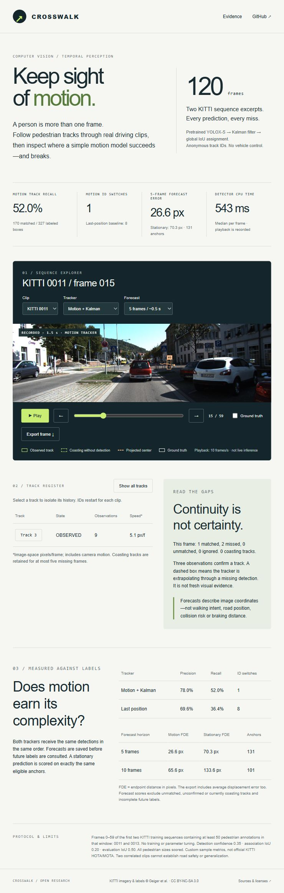

# Crosswalk · Pedestrian Motion Lab

Follow pedestrians across real driving frames and test whether motion improves continuity. Crosswalk combines pretrained YOLOX-S detections with an original constant-velocity Kalman tracker, global gated IoU assignment, short-gap coasting and image-space trajectory forecasts. An interactive browser report replays every evaluated frame and exposes misses, anonymous track IDs and forecast errors.



## Measured results

120 frames: frames 0–59 of KITTI tracking training sequences **0011 and 0013**. There are **327 annotated pedestrian boxes across frames**, representing 12 sequence-scoped ground-truth IDs—not 327 distinct people. The clips were chosen before inference by taking the first two lexicographic sequences with at least 50 pedestrian annotations in the first 60 frames. No fine-tuning, parameter search or frame removal was performed.

| Tracker | Precision | Recall | Matched / missed | ID switches |
|---|---:|---:|---:|---:|
| Motion + Kalman | 78.0% | 52.0% | 170 / 157 | 1 |
| Last-position baseline | 69.6% | 36.4% | 119 / 208 | 8 |

| Horizon | Eligible anchors | Motion ADE / FDE | Stationary ADE / FDE |
|---|---:|---:|---:|
| 5 frames (~0.5 s) | 131 | 14.8 / 26.6 px | 40.7 / 70.3 px |
| 10 frames (~1.0 s) | 101 | 27.5 / 65.6 px | 64.5 / 133.6 px |

ADE averages the predicted-center error across the horizon; FDE measures its final endpoint. Both forecasts start at the same current filtered center and use the same anchors. Only currently observed, confirmed, correctly matched tracks with the same target labeled throughout the horizon are eligible. This conditional sample excludes many hard cases. Timing: **543 ms median CPU detection**, 682 ms p95, and **0.40 ms median motion-tracker update** excluding detection. Playback at 10 frames/s is recorded; it is not live processing performance.

These are descriptive results on two correlated excerpts. They are **not official KITTI HOTA/MOTA, road-safety validation or evidence of generalization**. Many pedestrians are still missed.

## Open the preview

[**Open the public interactive demo**](https://ehsan-ch.github.io/pedestrian-motion-lab/) — no installation or login required. The replay is hosted on GitHub Pages and remains available when the development computer is off.

To run the same preview locally:

Python 3.11+:

```sh
python -m venv .venv
# Windows: .venv\Scripts\activate
# macOS/Linux: source .venv/bin/activate
python -m pip install -r requirements-lock.txt
python -m pip install --no-deps -e .
python -m motion_lab.cli serve
```

Open **http://127.0.0.1:8786/**. The preview uses committed results and JPEGs; no model download is needed. Play/pause, scrub, switch clips or trackers, inspect 5/10-frame projections, toggle ground truth, select a track and export a frame's JSON. The initial view is frame 15 of the first selected clip, a fixed presentation offset after confirmation warm-up. The entire 0–59 window remains available.

The report is buildless HTML/CSS/JavaScript with relative asset paths. It can also be served by a static host; no inference backend, API key, camera access or paid compute is needed for replay. It does not process new videos in the browser.

## Reproduce the evaluation

```sh
python scripts/setup.py
python -m motion_lab.cli prepare --data data
python -m motion_lab.cli evaluate --data data --output reports/custom
python -m unittest discover -s tests -v
```

Preparation retrieves only the selected original PNGs from the KITTI ZIP using bounded HTTP byte-range requests. The manifest records image and label-archive hashes and freezes labels before inference. Evaluation verifies the PNGs and compares annotations with the retained label archive. The detector model is revision-pinned and SHA-256 checked. A checksum mismatch aborts rather than silently substituting data. Use a new directory if a manifest or output report already exists.

`reports/results.json` contains raw detections, both trackers' frame snapshots, all annotations, matching outcomes, switch events, forecast samples, source/model/data hashes and environment details. Model inference used original PNGs; the JPEGs are compressed display derivatives. All tracker inputs are current detections and ordered frame numbers. Future labels are accessed only by the scoring pass, after causal snapshots are frozen.

## How tracking and scoring work

- **Motion tracker:** 8-state Kalman filter `[cx, cy, w, h, vx, vy, vw, vh]`, one frame per step, fixed process/measurement noise, gated global minimum-cost IoU assignment. Assignment is implemented locally and tested against exhaustive small-matrix solutions.
- **Last-position tracker:** holds its last observed box through gaps. Same detector, IoU gate, confirmation and expiry settings as the motion tracker.
- **Lifecycle:** 3 total observations confirm a track; retain through up to 5 consecutive missing frames. Only confirmed tracks are reported, including coasting predictions. IDs are sequence-local anonymous counters; expired IDs are never reused within a sequence.
- **Fixed settings:** detector confidence 0.35, detector NMS IoU 0.45, association IoU gate 0.20, scoring IoU 0.50. See `tracker.py` for the fixed noise matrices.
- **Matching:** score-descending, one-to-one matching to every Pedestrian box, including small and occluded instances. Unmatched Cyclist/Person_sitting overlaps and DontCare regions can be ignored; pedestrian duplicates remain false positives. Confirmed coasting predictions count in precision/recall too.
- **ID switches:** changes from a ground-truth ID's last matched tracker ID, including gaps. Independent frame matching can itself affect this count. This deliberately simple custom score is not TrackEval's continuity-aware assignment.

## Scope and limitations

Camera motion, perspective, detection jitter, occlusion and trajectory changes can all invalidate constant image-space velocity. There is no ego-motion compensation, world-coordinate calibration, depth, appearance-based re-identification, intent prediction, collision probability, planning or vehicle control. An ID is a temporary track number, not a personal identity. No faces or demographic attributes are analyzed.

The tracker is inspired by the established tracking-by-detection / Kalman-assignment family, including [SORT](https://arxiv.org/abs/1602.00763); it is an original implementation, not a claim to reproduce SORT or beat its benchmark. See [VALIDATION.md](VALIDATION.md) and [ATTRIBUTION.md](ATTRIBUTION.md). Software development was AI-assisted.
